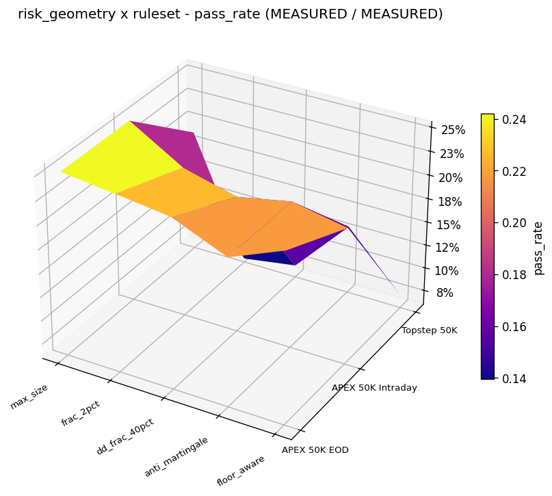
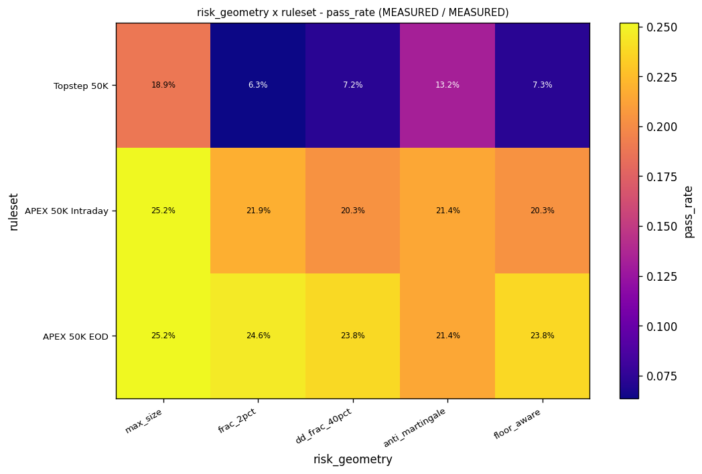
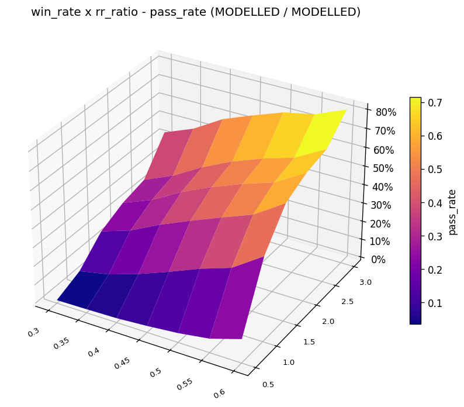
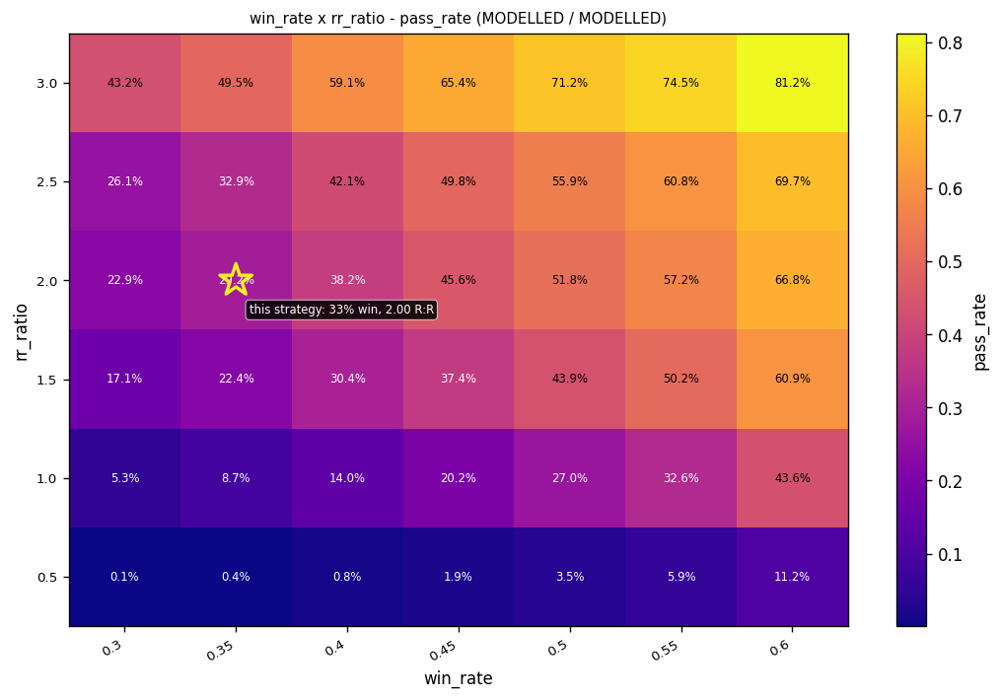
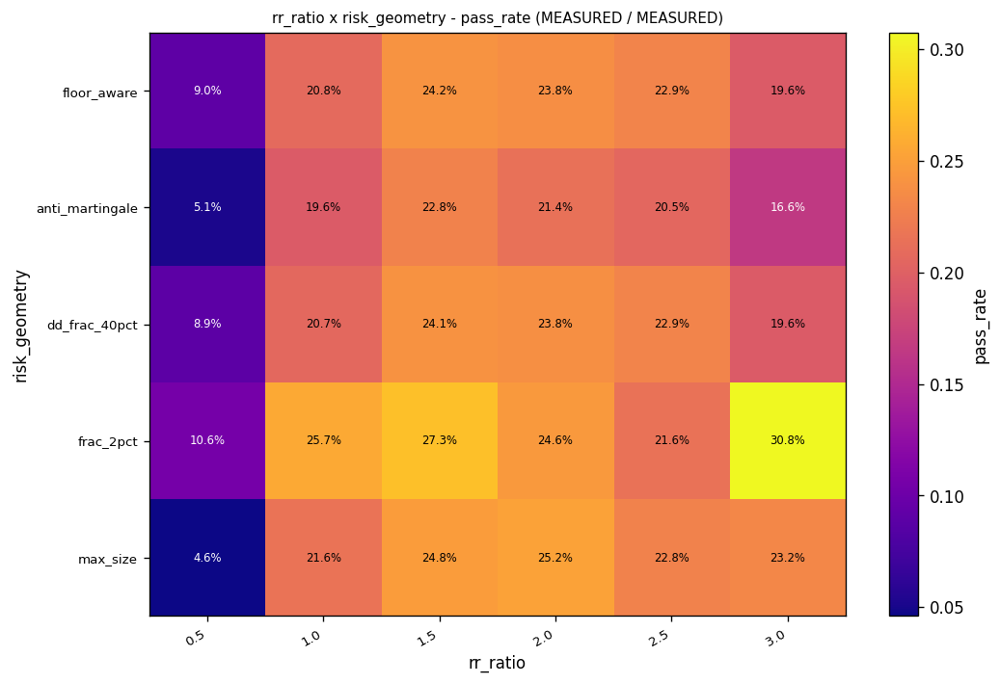

# prop-lab

**An agent-driven prop firm challenge lab.** Give it a trading idea in plain
language. It turns the idea into a backtestable strategy, tests it on real
free market data, checks whether the edge survives out of sample, and tells
you the probability of passing a prop firm evaluation — with every assumption
labelled.

```bash
git clone https://github.com/<owner>/prop-lab.git
cd prop-lab
python3 -m venv --system-site-packages .venv
.venv/bin/python -m pip install -e ".[dev]"
.venv/bin/python -m pytest -q
```

Requires Python 3.10+. Core dependencies: numpy, pandas, matplotlib, `yfinance`
and `requests` — the data adapters are part of the package, not an optional
extra, so a plain `pip install -e .` is enough to import `prop_lab.data`.

---

## Inspiration

**This project exists because of [DeltaTrend Trading](https://www.youtube.com/@deltatrendtrading)
(Thomas Skinner, also on [TikTok](https://www.tiktok.com/@deltatrendtrading)
and [Instagram](https://www.instagram.com/deltatrendtrading)).**

His pass-rate surface — pass rate as a function of win rate and
reward-to-risk ratio — is the public conversation this lab was built to
join. He popularised it on TikTok and YouTube using Topstep rules, and he
has publicly pushed back on creators who copied the surface without
understanding what the axes mean.

`prop-lab` takes that idea and does what a surface cannot: it measures it.
Where DeltaTrend's surface is a picture of a hypothesis, this package
re-runs the strategy at every R:R, bootstraps the real per-trade
distribution, tests the edge for statistical significance, and prints the
zero-edge baseline next to your number so a pass rate can be read as a
comparison rather than a score.

The credit goes to him for the idea. The implementation is independent, and
the difference in approach is stated everywhere it matters: this package
labels every axis `measured` or `modelled`, because the win-rate axis
**cannot** be measured from a backtest — forcing a different win rate means
fabricating trades that never happened.

---

## Start here: idea to number in one command

```bash
proplab fetch --source binance --symbol BTCUSDT --interval 15m --start 2023-01-01 --out data/
proplab report --strategy examples/strategies/trend_continuation.py:TrendContinuation \
    --data data/BTCUSDT_15m.csv --out reports/
```

That downloads free data, backtests, validates out of sample, simulates the
challenge 10,000 times, renders the surfaces and writes a Markdown report.
`--firm` defaults to all three firm presets so the ruleset axis is a real
axis; pass a single one (`--firm apex-50k-eod`) to model that account only.

## The one thing to understand before you trust a number

**A pass rate is a comparison, not a score.**

A challenge is not a coin toss. The profit target sits *above* your starting
balance and the trailing drawdown sits *below* it, so a random walk that
happens to run up early can reach the target before it ever retraces enough
to breach the floor. For the APEX 50K EOD rules, a strategy with **no edge
at all** scores around **27%**.

Every report therefore states the zero-edge baseline next to your number.
A strategy scoring 27% has demonstrated nothing. A strategy scoring 40% has
demonstrated something.

**The baseline is specific to the bracket, not a universal 27%.** With no
information at all, the chance a trade reaches its target before its stop is
`1 / (1 + R:R)` — 50.0% at 1:1, 33.3% at 1:2, 16.7% at 1:5 — so a 1.5R
strategy is measured against a 1.5R baseline, which lands near 28% under
Topstep-style rules rather than 27%. Comparing a 2R strategy against the 1:1
figure compares it with a different game. The CLI picks up the strategy's own
bracket; the API takes `rr`.

**And the baseline assumes no time limit.** The bracket model says every trade
ends at its stop or its target. A real run force-closes open positions at the
session close, so undecided trades leave at the close at an arbitrary R. A
bracket's *hit rate* then depends on how much time it is given — only its
expectation does not. Modelling that needs a volatility assumption, which is a
property of the market rather than of the rules, so the baseline describes a
challenge with no time limit and is the honest reference only for that case.
It is stated as a limitation rather than approximated away.

And a pass rate is not an edge either. The report also gives a confidence
interval on the mean R per trade, and the verdict says `no_edge` when that
interval includes zero. A narrow pass-rate interval is a precise
measurement of a possibly-worthless strategy.

## How to read the verdict

| verdict | meaning |
|---|---|
| `holds` | The edge survived out of sample, and it is statistically distinguishable from zero. |
| `degrades` | There is an edge, but it shrank out of sample. Part of the in-sample result does not generalise. |
| `no_edge` | No edge was detected. The mean R's confidence interval includes zero. Nothing was there to survive. |
| `fails` | The out-of-sample mean R is zero or negative, or the edge degraded badly. |

## Writing a strategy

Subclass `StrategyCore`, implement `on_bar`, return a `Signal`:

```python
from prop_lab.core import Bar, Signal, StrategyCore

class MyStrategy(StrategyCore):
    name = "my_strategy"

    def __init__(self, window: int = 20, rr_ratio: float = 2.0, **kwargs):
        super().__init__(window=window, rr_ratio=rr_ratio)
        self.window = window
        self.rr_ratio = rr_ratio

    def on_bar(self, bar: Bar, bar_index: int) -> Signal | None:
        # ... your condition ...
        return Signal(
            direction="long",        # 'long' or 'short'
            stop_distance=12.5,      # price points, MUST be > 0
            rr_ratio=self.rr_ratio,  # target = stop_distance * rr_ratio
            reason="my_long_setup",  # short machine-readable tag
            bar_index=bar_index,
            timestamp=bar.timestamp,
        )
```

A signal on bar `i` is filled at the **open of bar `i+1`**. If a bar
touches both the stop and the target, the stop is assumed to have filled
first — the pessimistic assumption.

### `on_bar` is only called while flat — read this before writing an indicator

**The engine calls `on_bar` only when no position is open.** While a trade is
live, bars pass without the strategy seeing them. This is deliberate (a
strategy is asked for an entry, not for a running commentary) and it is
harmless for a stateless rule: "close above the 20-bar high" can be computed
from a slice of history on any bar.

It is **not** harmless for anything that accumulates state bar by bar. If you
fold an RSI, an ATR or an EMA inside `on_bar` — `self._closes.append(bar.close)`
and average over the buffer — you are averaging over a *gapped* stream, because
the bars that passed while you were in a trade never arrived. The backtest
still runs, still produces trades, and the numbers look plausible. They are
computed from the wrong series.

Two bundled strategies have this latent problem
(`examples/strategies/doji_ema_trend.py` and `strategies/ema_trend_pullback.py`).
In an end-to-end test, a stateful implementation saw 36,818 of 49,628 bars and
produced stop distances that matched the ATR of no bar at all.

Two ways to stay correct:

- **Precompute** the indicator over the whole series and look it up by
  `bar_index`, or
- **keep the rule stateless**, computing from a window of history in the frame.

The session-range examples (`trend_continuation`, `opening_range_breakout`) are
largely unaffected because they only accumulate during the first minutes of a
session, when they are flat.

Write every assumption you made into a `notes` string on the class. The
report prints it, so the reader knows what was actually tested.

`AGENTS.md` is the full contract: how to resolve vague language, where to
get data, the command sequence, the honesty rules, and the failure modes
that have cost time in this project.

## Commands

| command | what it does |
|---|---|
| `proplab fetch` | download free market data |
| `proplab backtest` | run a backtest and print the trade statistics |
| `proplab walkforward` | purged out-of-sample validation with a verdict |
| `proplab montecarlo` | bootstrap the challenge 10,000 times |
| `proplab surface` | render the pass-rate surfaces as PNGs |
| `proplab report` | all of the above, plus a labelled Markdown report |
| `proplab inspect` | show a strategy's parameters and its assumptions |
| `proplab trades` | export the trade list so you can audit the result |
| `proplab sweep` | sweep strategy parameters; every cell is a real backtest |
| `proplab strategies` | list the built-in examples, firm presets and geometries |

## Reading the plots

The x-axis of the risk-geometry plots is **how many dollars are risked per
trade**. Those names are not decoration; each is a different sizing rule:

| label on the axis | what it actually does |
|---|---|
| `max_size` | risk a flat **$500** per trade, whatever the account is doing |
| `frac_2pct` | risk **2% of current equity** — compounds up and down with the account |
| `dd_frac_40pct` | risk **40% of the room left** between equity and the drawdown floor |
| `anti_martingale` | **$400**, plus 15% of profit above the starting balance |
| `floor_aware` | scale risk **down as equity approaches the floor** |

Every one of them is additionally capped at the firm's daily loss limit and at
the remaining drawdown room, and floored at $25, so none can risk the account
outright in a single trade.

The other axis, `ruleset`, is one firm's rulebook: profit target, drawdown
size and whether it trails end-of-day or intraday, daily loss limit, and any
consistency rule. The three presets are `apex-50k-eod`, `apex-50k-intraday`
and `topstep-50k`. Pass several at once to cross them:

```bash
proplab surface --strategy ... --firm apex-50k-eod,topstep-50k
```

Crossing firms is the point of that surface: the same strategy scores about
24% under APEX 50K EOD and about 8% under Topstep 50K, because Topstep adds a
consistency rule and a minimum-trading-days rule.

**A 3D plot is only drawn when both axes vary.** With a single firm the
`ruleset` axis is a constant, so the figure would be a curtain rather than a
surface; it is drawn as a heatmap instead. The 3D views you should expect are
the ruleset x risk-geometry cross and win-rate x R:R; the R:R x risk-geometry
surface is a heatmap because its cells are read one at a time.

### What the figures look like

All five below come from one command, on the bundled
`trend_continuation` example over BTCUSDT 15-minute bars, crossing all three
firm presets:

```bash
proplab surface --strategy examples/strategies/trend_continuation.py:TrendContinuation \
    --data data/BTCUSDT_15m.csv --session-open-hour 0 --attempts 2000
```

**Pass rate over risk geometry and firm ruleset** — the cross this project was
built for. Both axes are measured, and the title says so. Topstep's column
sits far below APEX's, which is the ruleset, not the strategy.



**The same numbers as a heatmap**, which is the readable view of a two-way
table — every cell annotated, no depth ambiguity.



**Pass rate over win rate and R:R** — the DeltaTrend Trading surface. Both
axes are modelled and the title says `MODELLED / MODELLED`, because a win rate
cannot be recovered from a backtest without inventing trades.





**Pass rate over R:R and risk geometry** — heatmap only, since its cells are
read one at a time. The R:R axis here is genuinely re-run at every value, so
the rows differ; a flat set of rows would mean the re-run never happened.




## Seeing how parameters fit the data

```bash
proplab sweep --strategy my_strategy.py:MyStrategy --data data/BTCUSDT_15m.csv \
    --param body_ratio=0.05,0.1,0.2 --param stop_atr_mult=2.0,3.0
```

Every combination is backtested for real and simulated for real. The output
gives the trade count, win rate, mean R, the edge's confidence interval and
the pass rate for each cell, and says how many cells have an edge that is
distinguishable from zero.

That last number is the one to read. Six cells and "0 of 6 have an edge"
is a complete answer, and a more useful one than any pass rate.

## Data

Free, no API key, no account:

| source | what you get |
|---|---|
| **Binance** | crypto spot, full history from listing, 1m to 1d, 24/7 |
| **Yahoo Finance** | decades of daily futures bars (`NQ=F`, `MNQ=F`, `ES=F`) |
| **Dukascopy** | tick-level FX and index history |
| **Any CSV** | drop it in and load it |

One rule decides more results than any other: **a futures trading day runs
18:00 ET to 17:00 ET.** Grouping bars by UTC calendar date splits every
session in two. For 24/7 crypto the session is the UTC calendar day
(`--session-open-hour 0`, which the CLI infers automatically for Binance).

Yahoo's continuous futures are **unadjusted**: they switch contract at
expiry and leave a roughly 1 percent gap that is a fake price move. The
loader warns about it. Do not hide the warning.

## The honesty rules

These are enforced by the code, not by good intentions.

**Bootstrap, never coin flip.** Every simulated trade outcome is drawn from
the real per-trade R-multiple array. If you see `rng.random() < win_rate`
in a challenge simulation, the number is meaningless.

**Block bootstrap by default.** Losses arrive in clusters and a trailing
drawdown is a path-dependent barrier, so the order of trades matters. An
i.i.d. bootstrap breaks the clusters apart and flatters the result. Pass
`session_dates` and use `compare_iid=True` to see the gap.

**Every surface axis is labelled `measured` or `modelled`.** The
risk-geometry axis is measured: the trades are fixed and only the sizing
changes, so every cell is a real simulation. The R:R axis is measured only
if the backtest is re-run. The win-rate axis is **always modelled**,
because forcing a different win rate means fabricating trades that never
happened. That surface is the one DeltaTrend Trading popularised on TikTok
and YouTube using Topstep rules, and this package says out loud that its
win-rate axis is parametric by construction.

**The sample size is printed.** Under 30 trades the pass rate is
illustrative, not an estimate. Every pass rate comes with its 95 percent
confidence interval, computed with the Wilson interval.

**The edge is tested for significance.** The report gives a bootstrap
confidence interval on the mean R per trade, so a strategy that is
statistically indistinguishable from a random sequence is told so instead
of being given a reassuring verdict.

**The warnings are in the report.** Small samples, degenerate bootstraps,
synthetic-day approximations, resampling gaps. They are not filtered out to
make the result look cleaner.

**The firm rules are dated.** Every preset records when it was checked
against the firm's published terms. Re-verify them.

See `docs/HONESTY.md` for the full argument.

## What is not modelled

State it when it matters. Slippage and commission. News gaps and intrabar
order of events. Contract scaling plans and payout delays. The firms
changing their rules. The correlation between the strategy and the person
running it.

And the one that matters most here: **the drawdown is checked on closed
trade equity, not intrabar.** The simulation sees one equity number per
trade, so an account that dips below the trailing floor mid-trade and
recovers into the close is scored as surviving. Real firms check the floor
continuously against equity including unrealised profit. **The pass rate
here is an upper bound, not a central estimate.**

## Attribution

The bootstrap-resampling approach and the risk-geometry framing are
credited to the [prop-risk-geometry](https://github.com/dsilva42/prop-risk-geometry)
project, originally published as `hunter547/prop-risk-geometry` under a
different owner (that older URL no longer resolves). It carries no license
file, so it is cited as the origin of the idea and **no code was taken from
it** — this package is an independent implementation.

**The inspiration for this entire project is
[DeltaTrend Trading](https://www.youtube.com/@deltatrendtrading)
(Thomas Skinner)**, whose pass-rate surface — pass rate against win rate
and R:R — started the public conversation this lab joins. He popularised it
on TikTok and YouTube using Topstep rules, and has publicly pushed back on
creators who copied the surface without understanding what the axes mean.
This package is built on that idea and credits it explicitly; the surfaces
here are the same subject, measured rather than asserted. See
[the Inspiration section](#inspiration) at the top of this file.

The purged walk-forward follows Lopez de Prado, "Advances in Financial
Machine Learning", chapters 7 and 12, and the conventions of
`github.com/eslazarev/purged-cross-validation`.

The Monte Carlo engine is checked against an exact dynamic-program
reference published at
[edgeveris.com](https://edgeveris.com/blog/monte-carlo-prop-challenge-probability).

The full prior-art review, with every license verified, is in
[`docs/PRIOR-ART.md`](docs/PRIOR-ART.md).

Cite these when you reuse the methods.

## Not financial advice

This is research tooling. It produces a number under a stated set of
assumptions. It does not predict the future, and the assumptions are
listed in every report so you can judge them yourself.

MIT licensed. See [`LICENSE`](LICENSE).
